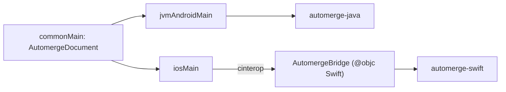

# automerge-kmp

One Kotlin Multiplatform API for [Automerge](https://automerge.org) documents on Android, JVM desktop
and iOS. The library is standalone: it depends on no app module, and the app uses only its common API.

## How it works

No official Automerge library exists for Kotlin Multiplatform. Each platform uses the official
wrapper of the same Rust core, so document bytes are interchangeable.



| Source set       | Wrapper                           | Native code                                                               |
|------------------|-----------------------------------|---------------------------------------------------------------------------|
| `jvmAndroidMain` | `org.automerge:automerge` (JNI)   | Desktop natives in the jar; Android ABIs in `org.automerge:androidnative` |
| `iosMain`        | `automerge-swift` (Swift package) | Rust static library in the `automergeFFI` XCFramework                     |

Kotlin/Native calls only Objective-C APIs, and `automerge-swift` is pure Swift. The `@objc` bridge in
`src/swift/AutomergeBridge/` closes that gap; the [spm4kmp](https://github.com/frankois944/spm4Kmp) Gradle
plugin compiles it and runs cinterop. The cinterop step embeds the `automergeFFI` static library in the
klib, so a consumer framework links it with no Xcode setup.

## Usage

```kotlin
val saved = AutomergeDocument().use { document ->
    document.putString("title", "Groceries")
    document.save()
}
val title = AutomergeDocument(saved).use { it.getStringOrNull("title") } // "Groceries", on any platform
```

`close()` frees the native document on JVM and Android; on iOS, ARC frees it.

## Wrapper versions

The wrappers release separately and wrap different Rust core versions. `gradle/libs.versions.toml`
records each wrapper version and, beside it, the core version it wraps (`automergeJava`,
`automergeJavaCore`, `automergeSwift`, `automergeSwiftCore`). A generated `BindingVersions` object
carries the wrapper versions into code.

`FixtureTest` guards the storage format across wrappers:

- `Fixtures.kt` holds one document saved by each wrapper version, Base64-encoded.
- Every platform loads every fixture.
- A wrapper version with no fixture fails `currentBindingHasFixture`; the failure message prints the line
  to add. The new fixture then loads on all other platforms.

Bump both wrappers together and keep old fixtures: they prove that new versions still read old documents.

## Android packaging

The `automerge-java` jar also carries desktop natives (`native/**`, about 35 MB). An Android app excludes
them:

```kotlin
android { packaging { resources { excludes += "/native/**" } } }
```
