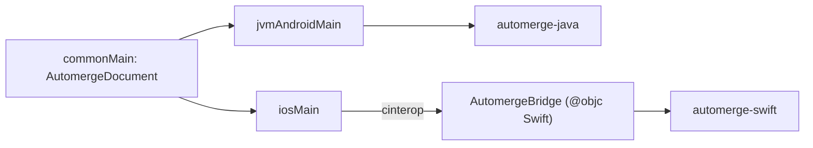

# automerge-kmp

One Kotlin Multiplatform API for [Automerge](https://automerge.org) documents on Android, JVM desktop
and iOS. The library is standalone: it depends on no app module, and the app uses only its common API.

## How it works

No official Automerge library exists for Kotlin Multiplatform. Each platform uses the official
wrapper of the same Rust core, so document bytes are interchangeable.



| Source set       | Wrapper                           | Native code                                                               |
|------------------|-----------------------------------|---------------------------------------------------------------------------|
| `jvmAndroidMain` | `org.automerge:automerge` (JNI)   | Desktop natives in the jar; Android ABIs in `org.automerge:androidnative` |
| `iosMain`        | `automerge-swift` (Swift package) | Rust static library in the `automergeFFI` XCFramework                     |

Kotlin/Native calls only Objective-C APIs, and `automerge-swift` is pure Swift. The `@objc` bridge in
`src/swift/AutomergeBridge/` closes that gap; the [spm4kmp](https://github.com/frankois944/spm4Kmp) Gradle
plugin compiles it and runs cinterop. The cinterop step embeds the `automergeFFI` static library in the
klib, so a consumer framework links it with no Xcode setup.

## Usage

```kotlin
val saved = AutomergeDocument().use { document ->
    document.transact { tx ->
        tx.put(tx.root, "colour", "sage")
        val title = tx.putObject(tx.root, "title", ObjType.TEXT)
        tx.spliceText(title, 0, 0, "Groceries")
        tx.mark(title, 0, 9, "bold", true, ExpandMark.AFTER)
    }
    document.save()
}
AutomergeDocument(saved).use { document ->
    val title = document.getObject(document.root, "title", ObjType.TEXT)
    title?.let(document::text) // "Groceries", on any platform
}
```

| API                                                               | Use                                                                                                                                |
|-------------------------------------------------------------------|------------------------------------------------------------------------------------------------------------------------------------|
| `transact { }`                                                    | All writes of one block are one Automerge change                                                                                   |
| `transactAt(heads) { }`                                           | One change on the document as it was at `heads`, for an editor that shows that older state. Returns the heads of the state it made |
| `get`, `getAll`, `keys`, `text`, `marks`                          | Reads; `getAll` returns every value of a conflict                                                                                  |
| `getString`, `getLong`, `getBoolean`, `getObject`                 | Typed reads; `null` when the key is missing or holds another type                                                                  |
| `heads()`                                                         | Sorted change hashes. Equal heads mean equal documents                                                                             |
| `merge(other)`, `save()`                                          | Set union of changes; full bytes with history                                                                                      |
| `AutomergeDocument(actorId)`, `AutomergeDocument(bytes, actorId)` | The actor that signs new changes                                                                                                   |

`close()` frees the native document on JVM and Android; on iOS, ARC frees it.

## Behaviour of the wrappers

Tests in `commonTest` guard text positions, integers, actors, marks and changes at past heads on
all three platforms.

| Fact                                                                                                                                                                                   | Effect on the API                                                                                                                                                   |
|----------------------------------------------------------------------------------------------------------------------------------------------------------------------------------------|---------------------------------------------------------------------------------------------------------------------------------------------------------------------|
| Both wrappers count text positions in Unicode code points. Kotlin strings count UTF-16 units                                                                                           | Positions in `spliceText`, `mark` and `Mark` are code points. The caller converts; an emoji is 1 position and 2 `Char`s                                             |
| Neither wrapper has a list move                                                                                                                                                        | The API has no lists. An ordered set is a map with an order key per entry                                                                                           |
| `automerge-java` 0.0.9 stores `NewValue.integer(long)` as a float                                                                                                                      | `put(Long)` writes an int, or a uint above `Int.MAX_VALUE`. A value below `Int.MIN_VALUE` throws on JVM and Android                                                 |
| `automerge-java` cannot set the actor of a loaded document                                                                                                                             | The JVM actual loads, then forks with the actor                                                                                                                     |
| `automerge-java` writes at past heads (`startTransactionAt`), also at heads that the document does not hold. `automerge-swift` can only fork at past heads, and a fork has a new actor | `transactAt` on JVM checks the heads with a fork first and keeps the document's actor. On iOS it forks, changes and merges; each such change has a new random actor |
| Two changes of one actor with one sequence number do not merge: both wrappers fail with "duplicate seq"                                                                                | Two documents never write with one actor. A fork on iOS therefore never gets the document's actor                                                                   |
| The public API of neither wrapper has block markers                                                                                                                                    | Paragraph formats such as headings are marks on a range                                                                                                             |
| `automerge-swift` has no unmark and no explicit transaction                                                                                                                            | `unmark` writes a null mark. On iOS a failing `transact` block keeps the writes made before the failure; on JVM it rolls back                                       |
| A put of the value that is already there is still a change                                                                                                                             | Callers that must not cause a sync compare first                                                                                                                    |
| Objective-C cannot express `throws` with an optional or primitive result                                                                                                               | The bridge returns a `kindMissing` value for a missing key, and objects instead of numbers                                                                          |

## Wrapper versions

The wrappers release separately and wrap different Rust core versions. `gradle/libs.versions.toml`
records each wrapper version and, beside it, the core version it wraps (`automergeJava`,
`automergeJavaCore`, `automergeSwift`, `automergeSwiftCore`). A generated `BindingVersions` object
carries the wrapper versions into code.

`FixtureTest` guards the storage format across wrappers:

- `Fixtures.kt` holds one document saved by each wrapper version, Base64-encoded.
- Every platform loads every fixture.
- A wrapper version with no fixture fails `currentBindingHasFixture`; the failure message prints the line
  to add. The new fixture then loads on all other platforms.

Bump both wrappers together and keep old fixtures: they prove that new versions still read old documents.

## Android packaging

The `automerge-java` jar also carries desktop natives (`native/**`, about 35 MB). An Android app excludes
them:

```kotlin
android { packaging { resources { excludes += "/native/**" } } }
```
